# Signals Reforged

     

Railway infrastructure for **vanilla minecarts**: the mod finds your track network by itself, routes carts to named
stations, protects them with block, chain and path signals, throws switches, and gives you signal boxes, timetables
and cargo logistics. No new train entities, no special track: you build with normal rails and minecarts.

**Status: public beta** (`0.1.0-beta.3`) for **Minecraft 26.3** with **NeoForge**. Expect bugs and back up your
worlds. A Fabric version is planned once the NeoForge version is complete.

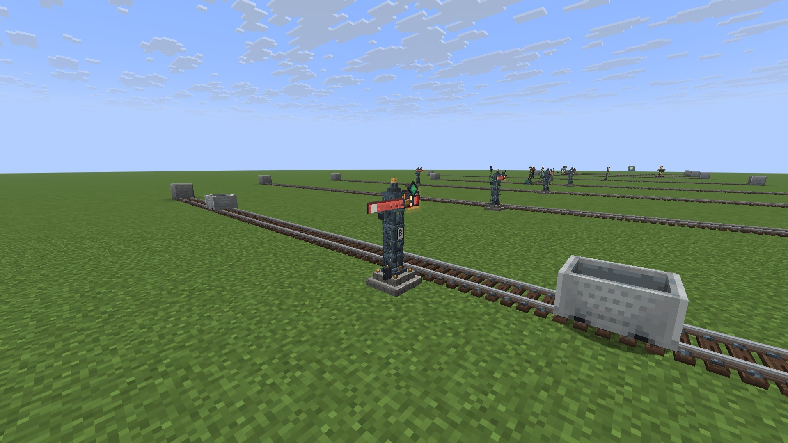

## Features

### Signals that cannot fail open
* **Block signals** split a line into blocks; a block is only cleared for one train at a time.
* **Chain signals** let a train in only if it can also get out again: put them in front of junctions and crossings.
* **Path signals** reserve the exact route through a junction, switch positions included; trains on routes that do
  not touch run in parallel.
* Unknown is always stop: unloaded chunks, a missing scan or a restart never turn a signal green.
* Semaphore or colour-light style, each aspect with its letter; right-click a signal to read why it shows what it
  shows. Substitute signal for faults, manual blocking, emergency stops per district or network.

### Routing and stations
* **Station markers** turn a rail into a named destination. Markers with the same name form one station with several
  platforms; trains get a free platform by priority.
* **Switch motors** turn vanilla junctions into controlled switches that are locked while a route is reserved.
* **Tickets** with one or more destinations, return trips and pattern destinations (`Freight *`, `re:...`);
  **Quick Ride** when you board a cart: search a station, pick it, go. Trains turn around when their next stop lies
  behind them.
* **Platform controllers**, **departure boards** with route-based estimates, and **lines** with headway timetables
  and delays.

### Signal box and consoles
* The **signal box** (3 x 2 x 2) shows a live map of the network: occupied, reserved, unknown and faulty track. Block
  signals, inspect routes, throw switches, send trains, manage lines and rights.
* The **rail network controller** is a map desk for its district; the **conductor tablet** opens a desk from afar.
* Roles (owner, dispatcher, operator, viewer) for the network and for single stations or depots.

### Cargo
* **Loading docks** with cranes move goods between carts and chests, barrels or **cargo buffers**.
* Cargo orders with destination, filter, amount, priority, deadline and up to four stops.
* Transfers are journaled: unloads, disconnects and restarts neither lose nor duplicate items.
* **Cart hoppers** fill or empty carts that pass by.

### Carts, consists and special rails
* Couple carts into trains with the **rail configurator**; the **cart engine** drives a train, the **chunkloader
  upgrade** keeps it running (only when an operator allows chunk loading).
* **Transport**, **limiter** and **teleport rails**, **rail links** that let blocks and signals span a gap, and a **rail crossing** block.
* **Train detectors** and **signal repeaters** for redstone; comparator outputs on many devices.

### Learn it in the game
* The **Signalling Manual** teaches the basics in nine steps with drawn figures and tasks that tick off when you do
  them.
* Eight **example layouts** ship inside the mod; see the [wiki](../../wiki/Example-Layouts).

## Pictures

| | |
|---|---|
| 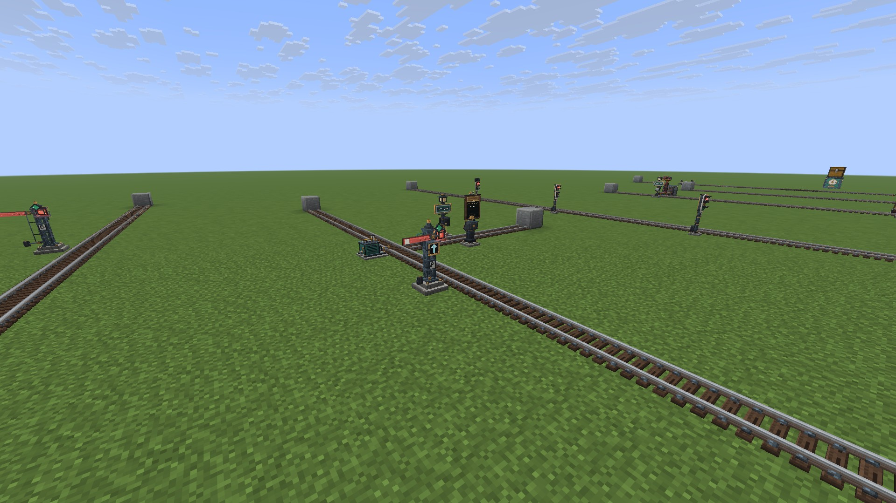 | 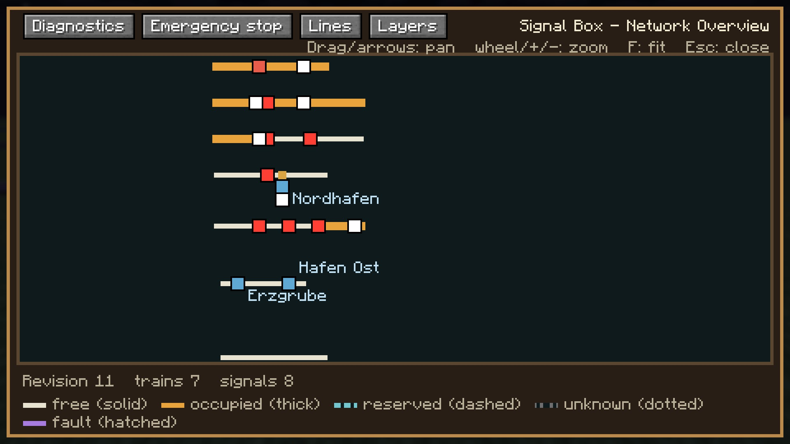 |
| 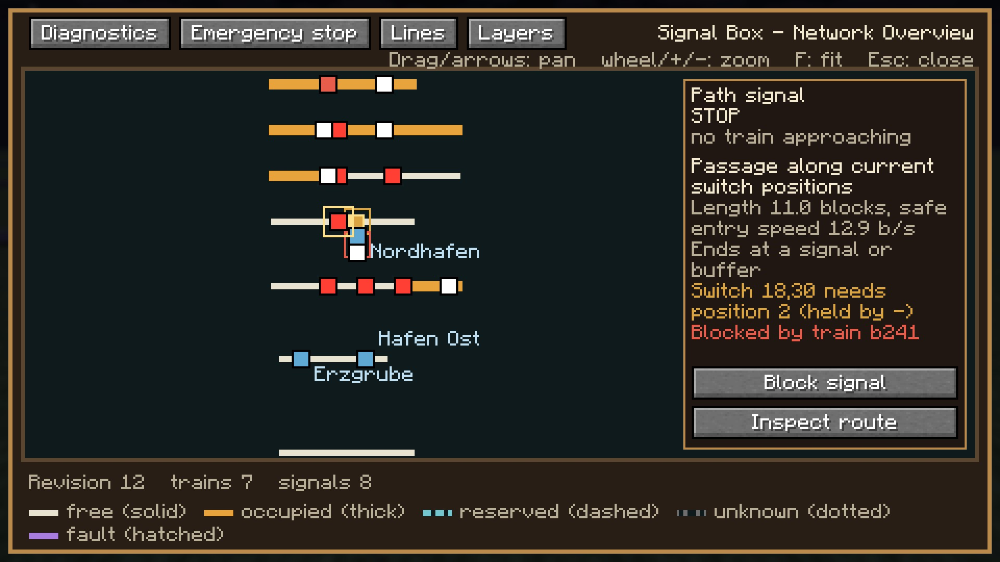 | 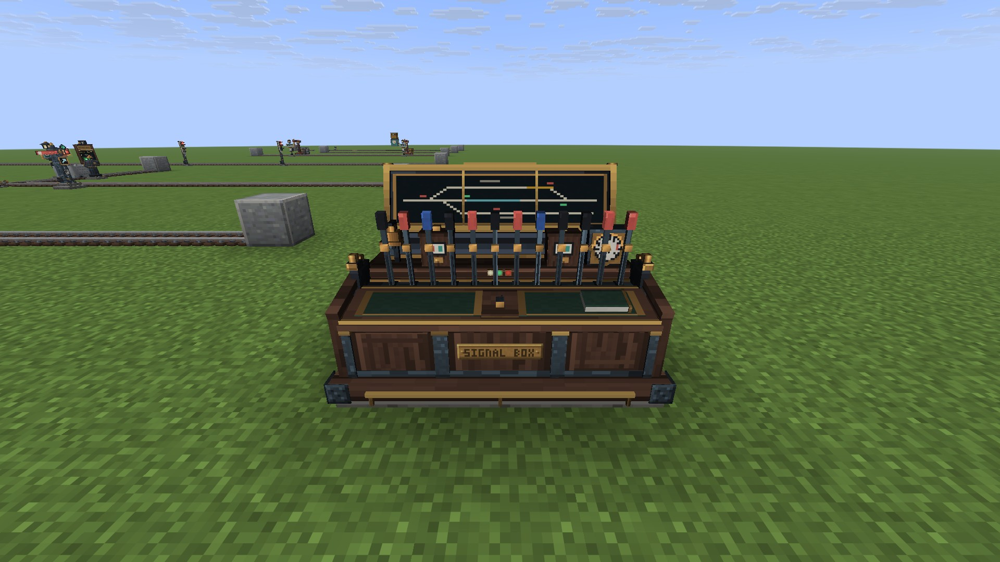 |
| 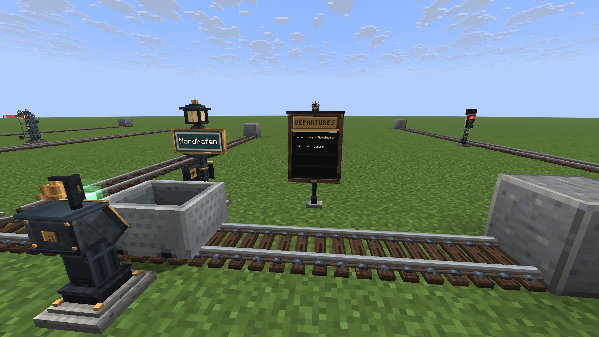 | 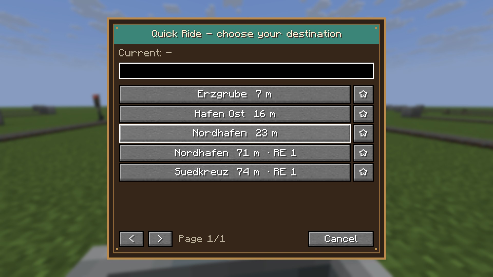 |
| 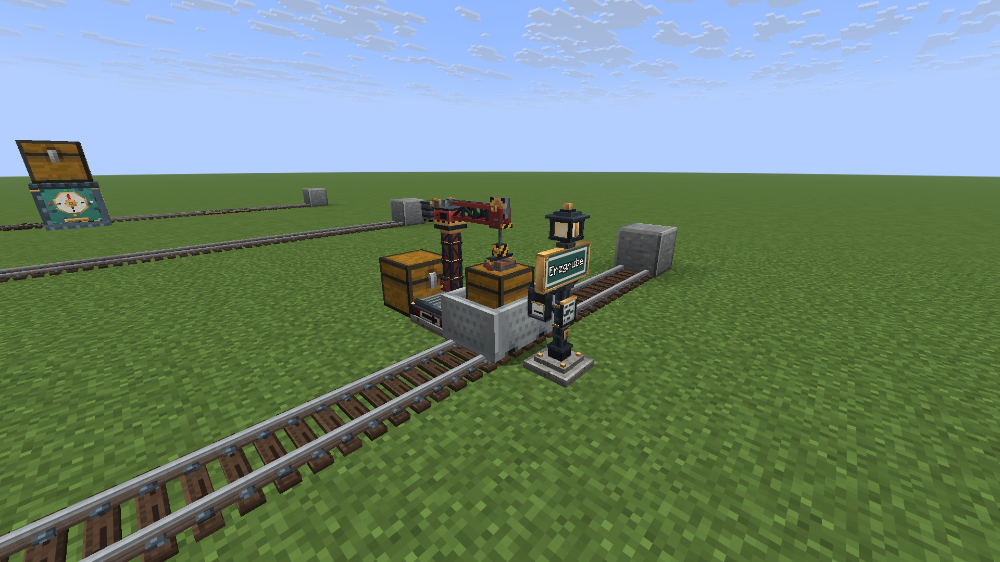 | 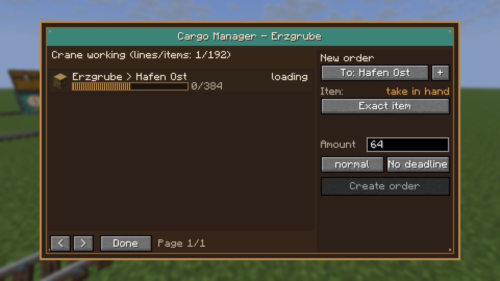 |
| 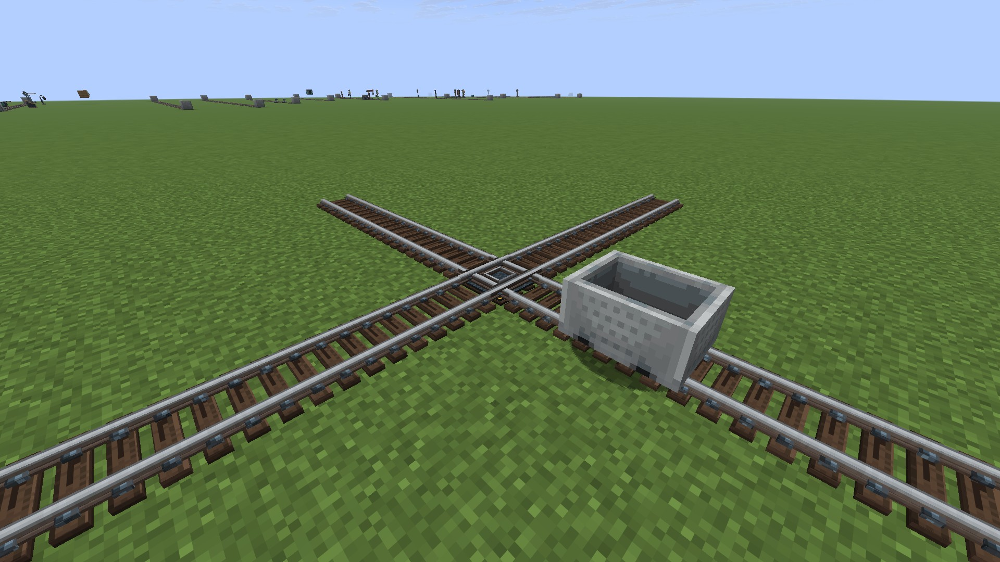 | 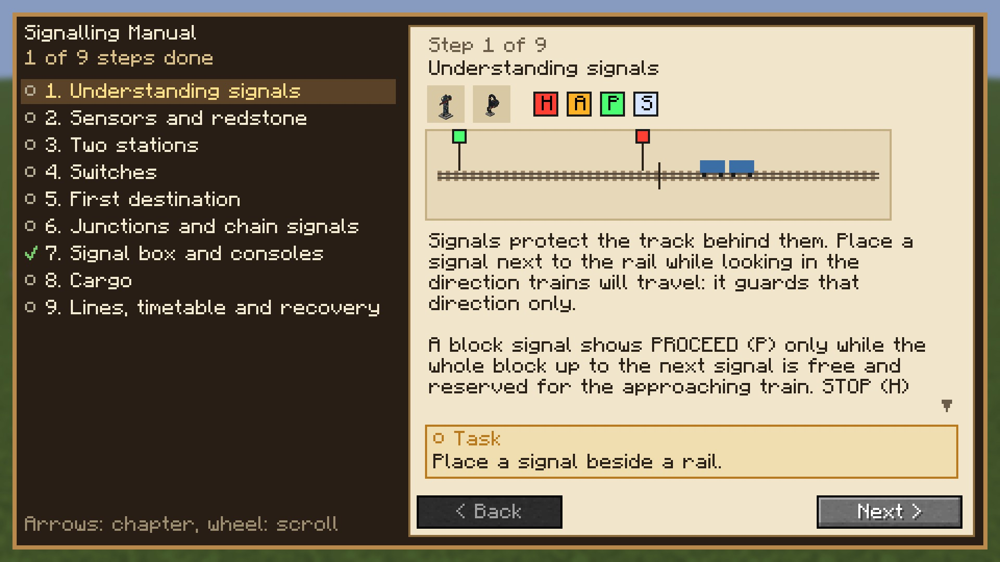 |

## Download and requirements

* Download: **[Modrinth](https://modrinth.com/mod/signals-reforged)** · **[CurseForge](https://www.curseforge.com/minecraft/mc-mods/signals-reforged)** · [releases of this repository](../../releases). Please download only from these pages.
* Minecraft **26.3** exactly, **NeoForge 26.3.0.109** or newer, Java 25.
* Install on the **server and every client**. No other mods are required.

## Server and multiplayer

* Everything is decided on the server; clients only show it.
* No chunk is force-loaded unless an operator allows the chunkloader upgrade.
* Teleport rails between dimensions are off until an operator turns them on (server config).
* Commands: `/signals status`, `rescan`, `scan-local`, `validate`, `repair`, `rights`, `role`, `station`, `depot`,
  `emergency`, `calls`, `chunkloads`, `diagnostics export` (details in the wiki).

## Help and bugs

* [Wiki](../../wiki): getting started, example layouts, FAQ.
* [Report a bug](../../issues/new?template=bug_report.yml) · [Suggest a feature](../../issues/new?template=feature_request.yml)

## License

All rights reserved (Signals Reforged License, see [LICENSE](LICENSE)): play, stream and use it in modpacks unchanged; no
modified or re-uploaded copies. Signals Reforged is an unofficial, independently developed successor
inspired by "Signals" by MineMaarten. It contains no code and no assets from that project and is not affiliated with
or endorsed by MineMaarten, Mojang or Microsoft.
