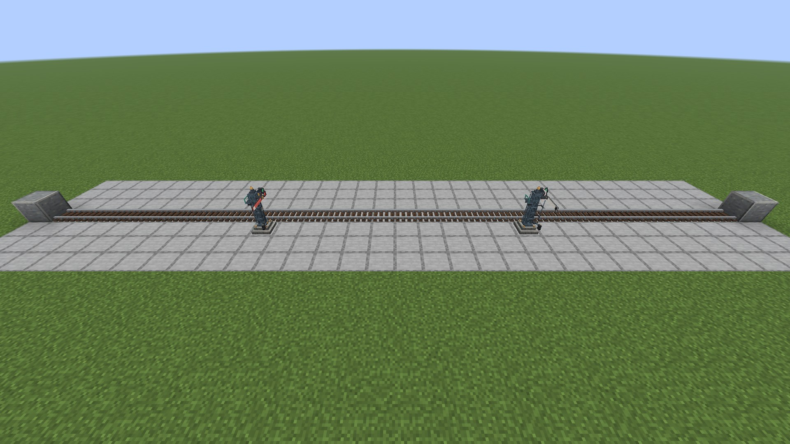
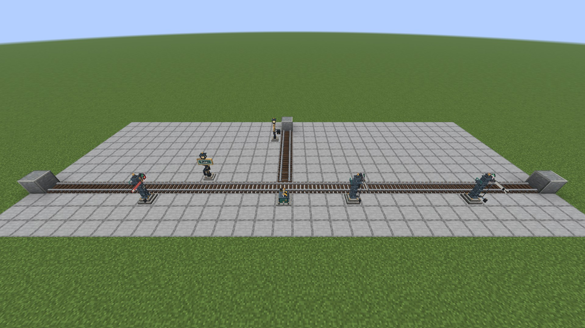
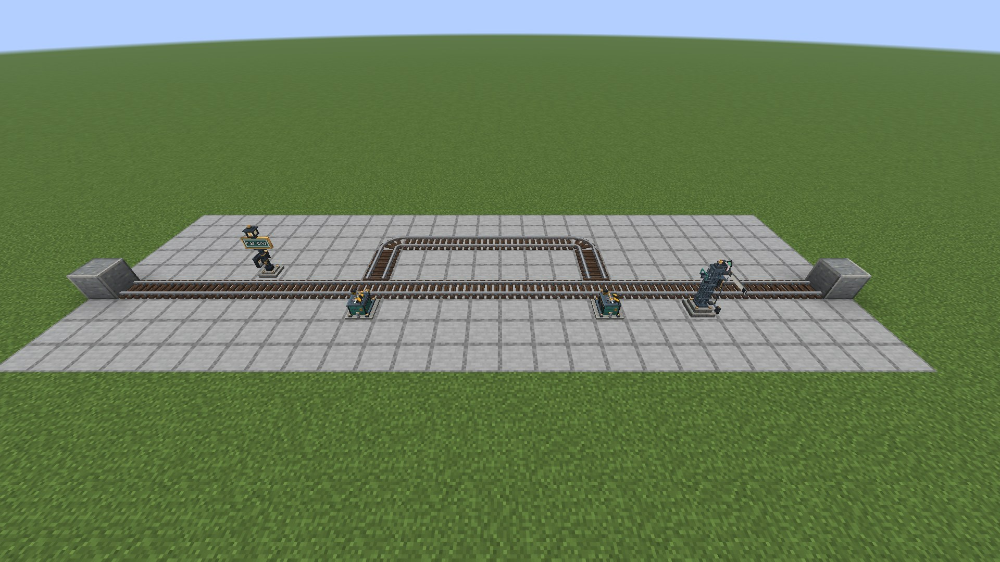
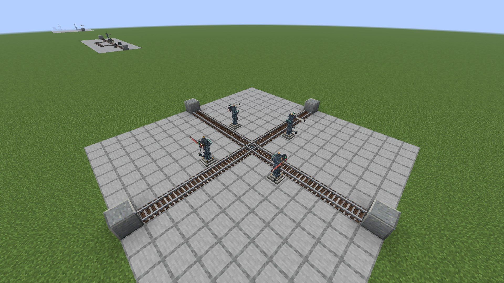
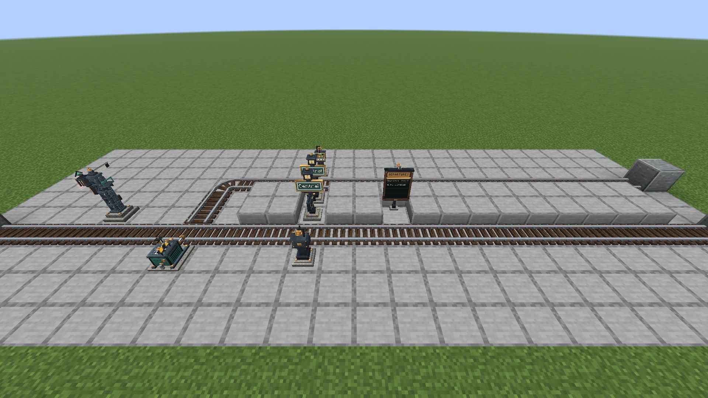
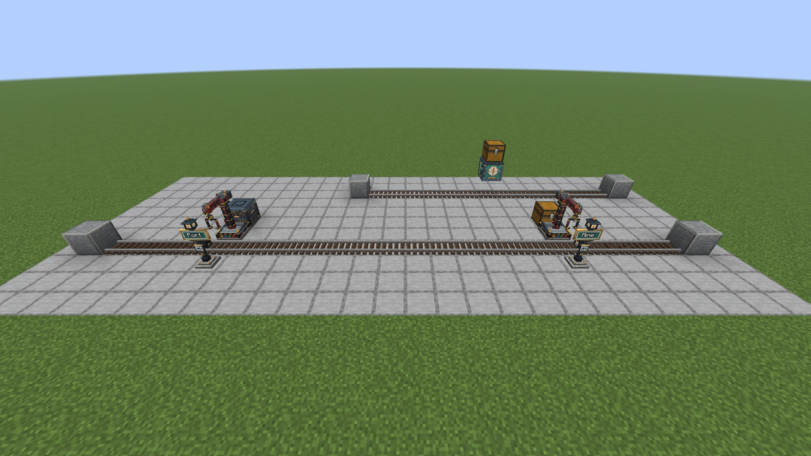
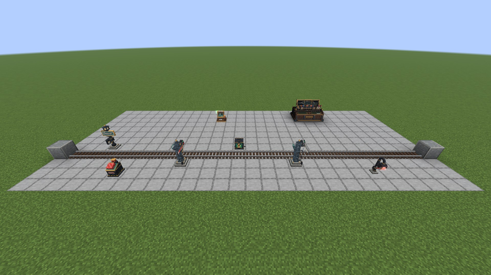
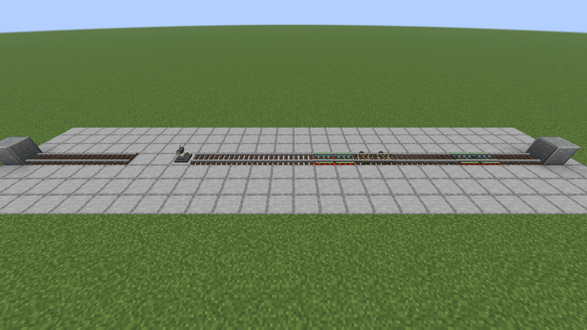

# Example layouts

Small, working layouts for the main features. Each one comes with screenshots, a step-by-step "try it", its material
list and a structure file. The structures ship inside the mod, so you can place any of them in a creative world:

```
/place template signalsreforged:wiki/<name> ~ ~-1 ~
```

| Layout | Shows | Name |
|---|---|---|
| [Block signals on a line](Layout-Block-Signals) |  | `block_signals` |
| [Junction with chain and path signals](Layout-Junction) |  | `junction` |
| [Passing loop with detour](Layout-Passing-Loop) |  | `passing_loop` |
| [Rail crossing protected by signals](Layout-Rail-Crossing) |  | `rail_crossing` |
| [Station with two platforms](Layout-Station-Platforms) |  | `station_platforms` |
| [Cargo line with docks, buffer and cart hopper](Layout-Cargo-Line) |  | `cargo_line` |
| [Signal box and control devices](Layout-Control-Room) |  | `control_room` |
| [Transport rails, limiter rails and a rail link](Layout-Special-Rails) |  | `special_rails` |

All pictures come from a real game: the layouts are built and run by the development client
(`./gradlew runClient -Psignals.wiki=true`), which also exports the structures and material lists
(`python tools/wiki_layouts.py` then copies the pictures and fills the tables).
