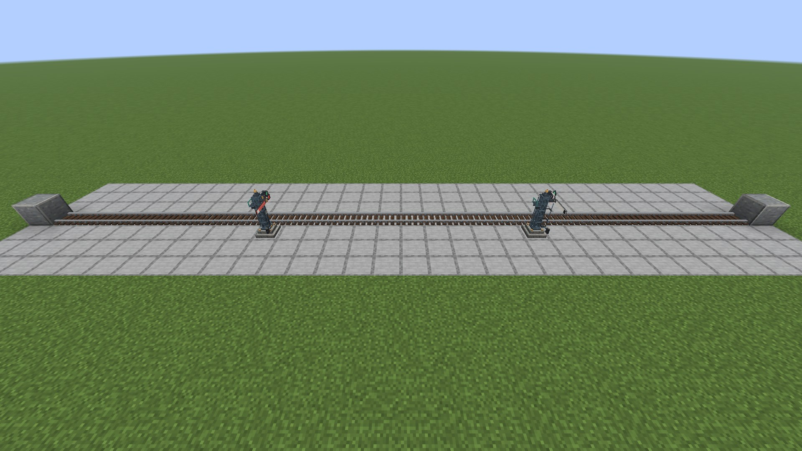
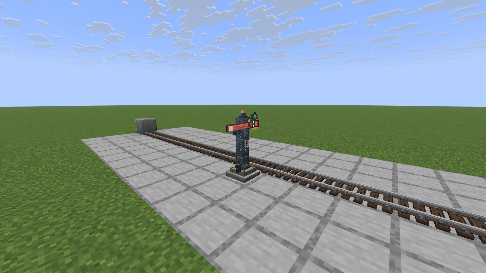
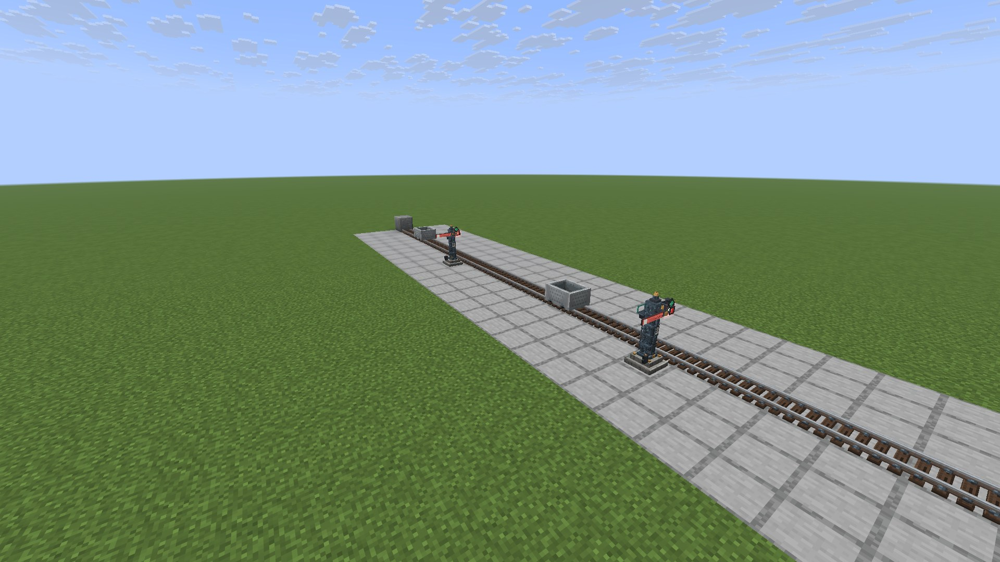

# Block signals on a line

A straight line split into blocks by two block signals. It is the smallest useful signal setup and the first thing
to build on any line with more than one train.



## What it shows

* Two **block signals** beside the track, placed on the left of the direction of travel (here: trains run east).
  Each one guards the block from itself to the next signal.
* A signal shows **PROCEED** only while its whole block is free and reserved for the approaching train. Otherwise it
  shows **STOP** and holds the cart in front of it.
* The signal before an occupied block also shows **APPROACH** ("next signal shows stop") once the train behind can
  see it.



## Try it

1. Put a minecart on the east end of the line (behind the second signal) and leave it there.
2. Push a second minecart from the west end towards the east.
3. It passes the first signal, then stops at the second one: the block ahead is occupied. Both signals show STOP,
   because the first block is now occupied by the waiting cart.
4. Break or move the parked cart: the second signal clears and the waiting cart continues.



Right-click a signal to read why it shows its aspect (for example `BLOCK_OCCUPIED`). Sneak + right-click switches
between the semaphore and the colour-light style.

## Build your own

* Place a signal beside the rail **while looking in the direction trains travel**; it guards only that direction.
* Leave at least a train length between two signals, so a whole train fits into a block.
* Unknown is always stop: a block reaching into an unloaded chunk keeps its signal at STOP.

## Place it in your world

The layout ships inside the mod. In a creative world with cheats, stand on flat ground and run:

```
/place template signalsreforged:wiki/block_signals ~ ~-1 ~
```

The layout starts at your position and extends to the east (+X) and south (+Z); its floor replaces the ground block
under your feet. You can also use a structure block in **Load** mode with the name `signalsreforged:wiki/block_signals`.
The same structure as a file: [block_signals.nbt](https://github.com/CptGummiball/SignalsReforged/raw/main/structures/block_signals.nbt) (for example for
`<world>/generated/signalsreforged/structure/wiki/block_signals.nbt` or a world editor).

You may rotate it (for example `/place template signalsreforged:wiki/block_signals ~ ~-1 ~ clockwise_90`), but do **not mirror**
it: repeaters, rail links and the signal box would point the wrong way. Station markers in a copied layout become new
stations with the same names (and the same private setting); tickets for the original stations stay valid.

## Materials

<!-- materials:begin -->
Size: 32 x 6 x 7 blocks (width x height x depth, floor included). 258 blocks in total.

| Block | Count |
|---|---:|
| Block Signal (`signalsreforged:block_signal`) | 2 |
| Polished Andesite (`minecraft:polished_andesite`) | 2 |
| Rail (`minecraft:rail`) | 30 |
| Smooth Stone (`minecraft:smooth_stone`) | 224 |
<!-- materials:end -->
