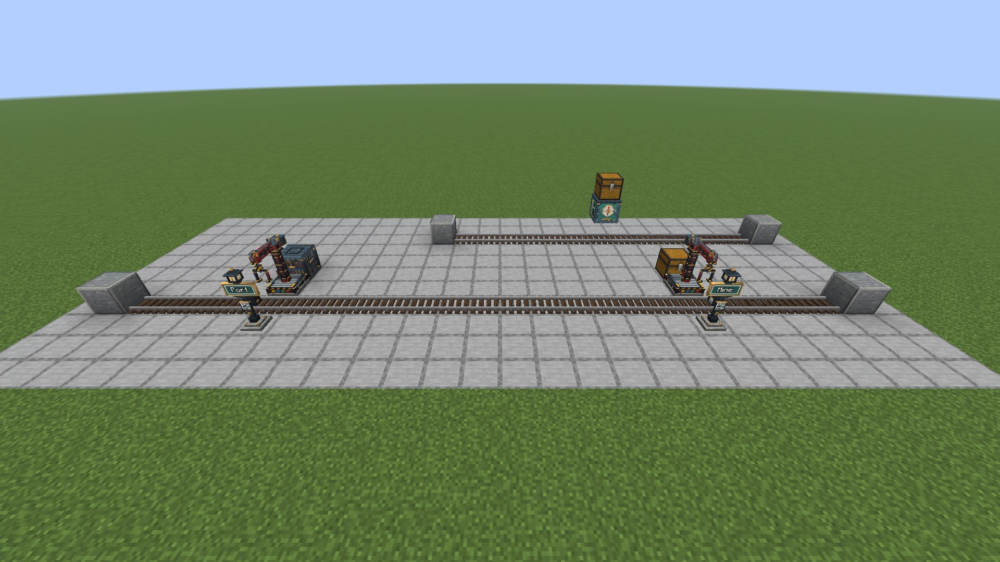
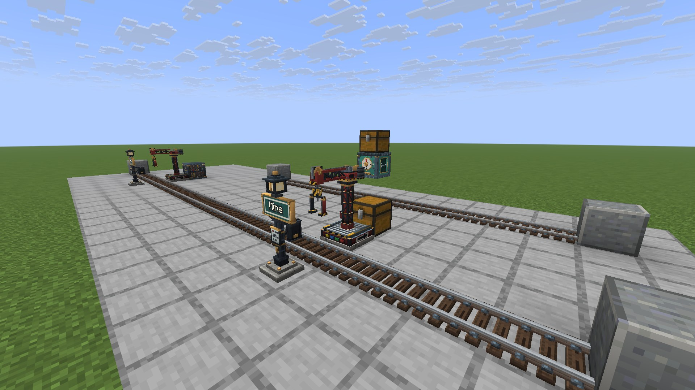
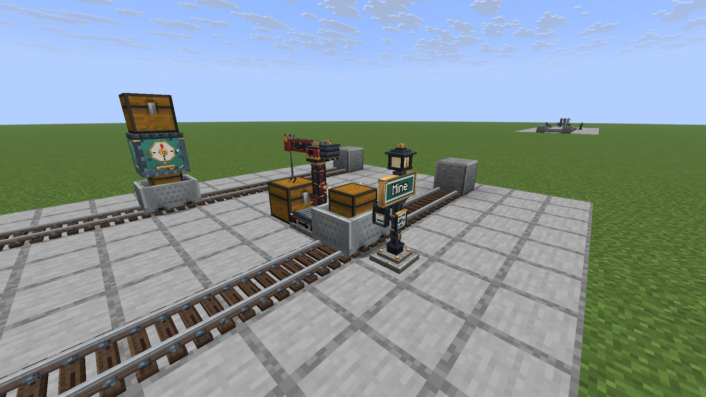

# Cargo line with docks, buffer and cart hopper

Two freight stations, `Mine` and `Port`. A loading dock fills a chest minecart at the mine; the dock at the port
unloads it into a cargo buffer. A cart hopper on a side track shows the simple way to fill carts without orders.



## What it shows

* A **loading dock** beside each station rail, with the container behind it: a chest at `Mine`, a **cargo buffer**
  at `Port`.
* The docks bind to the nearest station marker, which then counts as a freight station.
* A **cart hopper** above the side track with a chest on top: it fills chest minecarts that stand under it.



## Try it

1. Fill the chest behind the mine dock (for example with logs) and put a chest minecart on the station rail at `Mine`.
2. Right-click the mine dock to open the cargo manager and create an order: destination `Port`, the item, an amount.
3. The crane loads the cart, the cart drives to `Port`, and the dock there unloads it into the cargo buffer.
4. Put a chest minecart under the cart hopper and some items into the chest on top: the hopper fills the cart.



## Build your own

* Transfers are journaled: unloads, disconnects or restarts neither lose nor duplicate items.
* An order can serve up to four destinations; the nearest open stop comes first.

## Place it in your world

The layout ships inside the mod. In a creative world with cheats, stand on flat ground and run:

```
/place template signalsreforged:wiki/cargo_line ~ ~-1 ~
```

The layout starts at your position and extends to the east (+X) and south (+Z); its floor replaces the ground block
under your feet. You can also use a structure block in **Load** mode with the name `signalsreforged:wiki/cargo_line`.
The same structure as a file: [cargo_line.nbt](https://github.com/CptGummiball/SignalsReforged/raw/main/structures/cargo_line.nbt) (for example for
`<world>/generated/signalsreforged/structure/wiki/cargo_line.nbt` or a world editor).

You may rotate it (for example `/place template signalsreforged:wiki/cargo_line ~ ~-1 ~ clockwise_90`), but do **not mirror**
it: repeaters, rail links and the signal box would point the wrong way. Station markers in a copied layout become new
stations with the same names (and the same private setting); tickets for the original stations stay valid.

## Materials

<!-- materials:begin -->
Size: 27 x 6 x 11 blocks (width x height x depth, floor included). 345 blocks in total.

| Block | Count |
|---|---:|
| Cargo Buffer (`signalsreforged:cargo_buffer`) | 1 |
| Cart Hopper (`signalsreforged:cart_hopper`) | 1 |
| Loading Dock (`signalsreforged:loading_dock`) | 2 |
| Station Marker (`signalsreforged:station_marker`) | 2 |
| Chest (`minecraft:chest`) | 2 |
| Polished Andesite (`minecraft:polished_andesite`) | 4 |
| Rail (`minecraft:rail`) | 36 |
| Smooth Stone (`minecraft:smooth_stone`) | 297 |
<!-- materials:end -->
