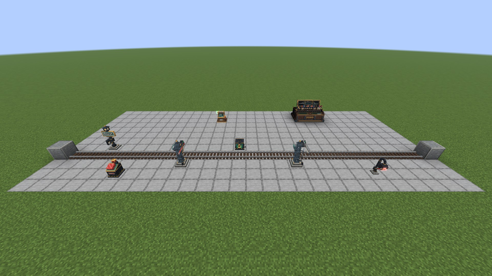
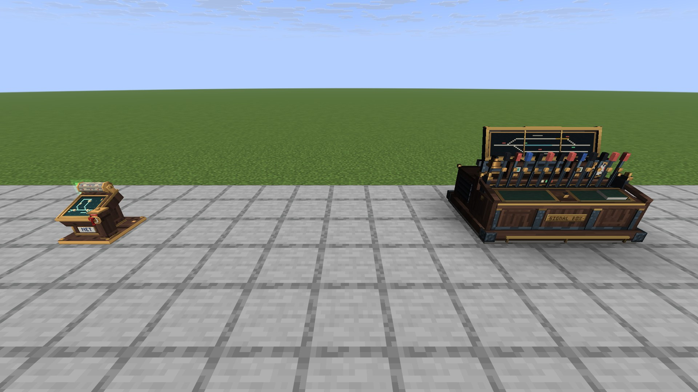
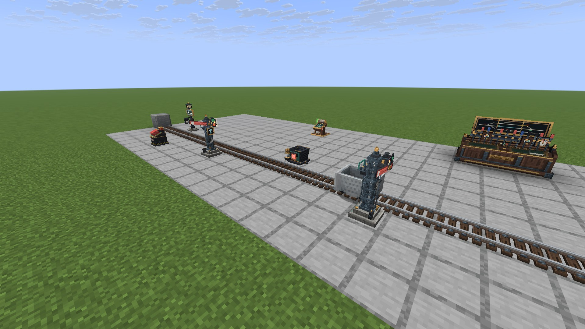

# Signal box and control devices

A line with the control devices around it: a signal box, a rail network controller, a signal repeater, a train
detector and an emergency stop.



## What it shows

* The **signal box** (3 x 2 x 2 blocks) is the main console: a live map of the network. Select a signal to block it
  or inspect its route, a switch to throw it, a train to send it to a station.
* The **rail network controller** is a map desk for its district (here `Depot District`).
* The **signal repeater** shows the aspect of the block signal next to it and puts it out as redstone.
* The **train detector** beside the track reports trains on redstone and to comparators.
* The **emergency stop** pedestal stops the district; releasing it needs a second, confirming press.



## Try it

1. Right-click the signal box or the controller to open the map.
2. Push a minecart from the west end and watch it on the map; the detector lights up when the cart passes it.
3. Press the emergency stop: every signal of the district shows STOP. Release it from the pedestal or a console.



## Build your own

* Every console action needs its role; viewing is free. Roles are managed in the rights window (button "Rights..." in
  the diagnostics view of a console) or with `/signals rights`.
* Link a repeater with the rail configurator: right-click the signal (stores it), then sneak + right-click the
  repeater.

## Place it in your world

The layout ships inside the mod. In a creative world with cheats, stand on flat ground and run:

```
/place template signalsreforged:wiki/control_room ~ ~-1 ~
```

The layout starts at your position and extends to the east (+X) and south (+Z); its floor replaces the ground block
under your feet. You can also use a structure block in **Load** mode with the name `signalsreforged:wiki/control_room`.
The same structure as a file: [control_room.nbt](https://github.com/CptGummiball/SignalsReforged/raw/main/structures/control_room.nbt) (for example for
`<world>/generated/signalsreforged/structure/wiki/control_room.nbt` or a world editor).

You may rotate it (for example `/place template signalsreforged:wiki/control_room ~ ~-1 ~ clockwise_90`), but do **not mirror**
it: repeaters, rail links and the signal box would point the wrong way. Station markers in a copied layout become new
stations with the same names (and the same private setting); tickets for the original stations stay valid.

## Materials

<!-- materials:begin -->
Size: 28 x 6 x 12 blocks (width x height x depth, floor included). 372 blocks in total.

| Block | Count |
|---|---:|
| Block Signal (`signalsreforged:block_signal`) | 1 |
| Emergency Stop (`signalsreforged:emergency_stop`) | 1 |
| Path Signal (`signalsreforged:path_signal`) | 1 |
| Rail Network Controller (`signalsreforged:rail_network_controller`) | 1 |
| Signal Box (`signalsreforged:signal_box`) | 1 |
| Signal Repeater (`signalsreforged:signal_repeater`) | 1 |
| Station Marker (`signalsreforged:station_marker`) | 1 |
| Train Detector (`signalsreforged:train_detector`) | 1 |
| Polished Andesite (`minecraft:polished_andesite`) | 2 |
| Rail (`minecraft:rail`) | 26 |
| Smooth Stone (`minecraft:smooth_stone`) | 336 |
<!-- materials:end -->
