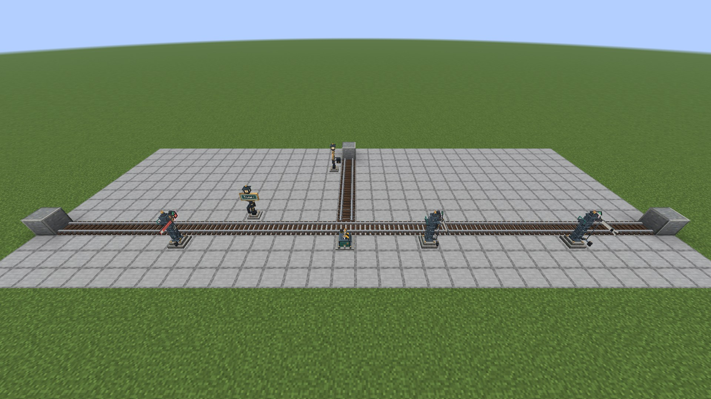
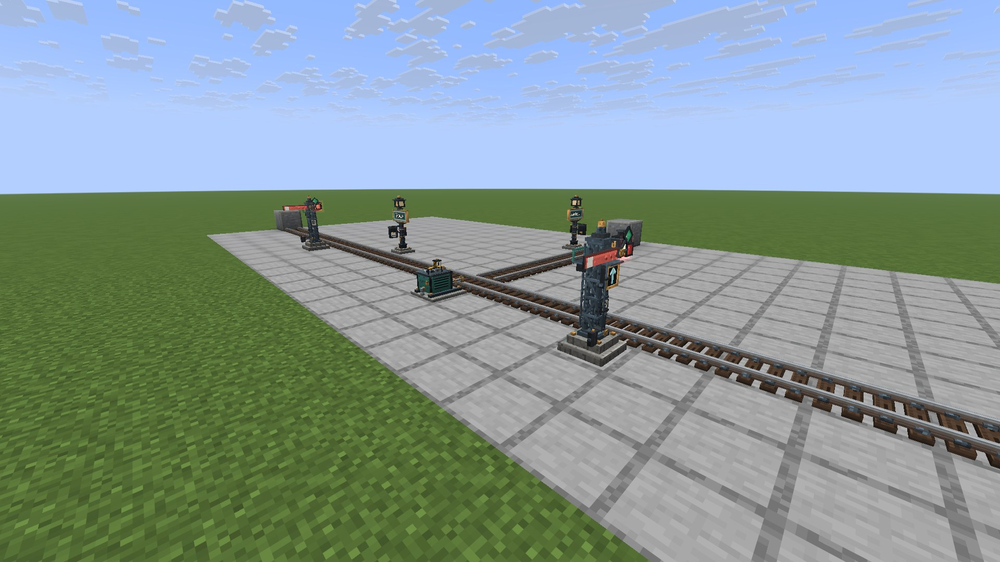
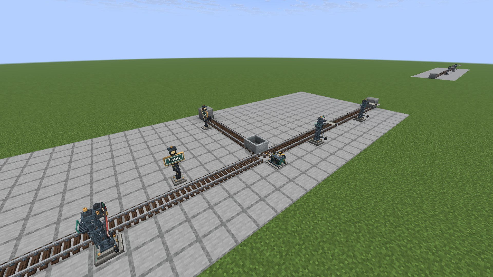

# Junction with chain and path signals

A main line with a branch to a station. A chain signal and a path signal protect the junction; a switch motor
throws the junction rail for routed trains.



## What it shows

* A vanilla **T junction** becomes a controlled switch with a **switch motor** beside the junction rail. The motor
  throws the rail for a routed train and locks it while the route is reserved.
* A **path signal** in front of the junction reserves the exact route through it, switch position included, for one
  train at a time.
* A **chain signal** before the path signal lets a train in only if it can also get out again, so no train stops in
  the middle of the junction.
* A **block signal** on the main line behind the junction ends the protected section.
* Two **station markers**: `Harbour` at the end of the branch and `Town` on the main line.



## Try it

1. Take a **Ticket** and right-click the `Harbour` station marker with it (the ticket now lists Harbour).
2. Put a minecart on the west end of the main line and right-click it with the ticket.
3. Push the cart east. The path signal reserves the route to Harbour, the switch motor throws the junction and the
   cart turns into the branch and stops at the station.
4. Do the same with the `Town` marker: the switch stays straight and the cart runs along the main line.



Right-click the switch motor to see its position, its lock and the reason. The route inspector in the signal box
shows the reserved path.

## Build your own

* The switch motor stands beside the junction rail, facing it.
* A locked or occupied switch never moves.
* Use path signals wherever routes split or cross; trains on routes that do not touch run in parallel.

## Place it in your world

The layout ships inside the mod. In a creative world with cheats, stand on flat ground and run:

```
/place template signalsreforged:wiki/junction ~ ~-1 ~
```

The layout starts at your position and extends to the east (+X) and south (+Z); its floor replaces the ground block
under your feet. You can also use a structure block in **Load** mode with the name `signalsreforged:wiki/junction`.
The same structure as a file: [junction.nbt](https://github.com/CptGummiball/SignalsReforged/raw/main/structures/junction.nbt) (for example for
`<world>/generated/signalsreforged/structure/wiki/junction.nbt` or a world editor).

You may rotate it (for example `/place template signalsreforged:wiki/junction ~ ~-1 ~ clockwise_90`), but do **not mirror**
it: repeaters, rail links and the signal box would point the wrong way. Station markers in a copied layout become new
stations with the same names (and the same private setting); tickets for the original stations stay valid.

## Materials

<!-- materials:begin -->
Size: 32 x 6 x 13 blocks (width x height x depth, floor included). 462 blocks in total.

| Block | Count |
|---|---:|
| Block Signal (`signalsreforged:block_signal`) | 1 |
| Chain Signal (`signalsreforged:chain_signal`) | 1 |
| Path Signal (`signalsreforged:path_signal`) | 1 |
| Station Marker (`signalsreforged:station_marker`) | 2 |
| Switch Motor (`signalsreforged:switch_motor`) | 1 |
| Polished Andesite (`minecraft:polished_andesite`) | 3 |
| Rail (`minecraft:rail`) | 37 |
| Smooth Stone (`minecraft:smooth_stone`) | 416 |
<!-- materials:end -->
