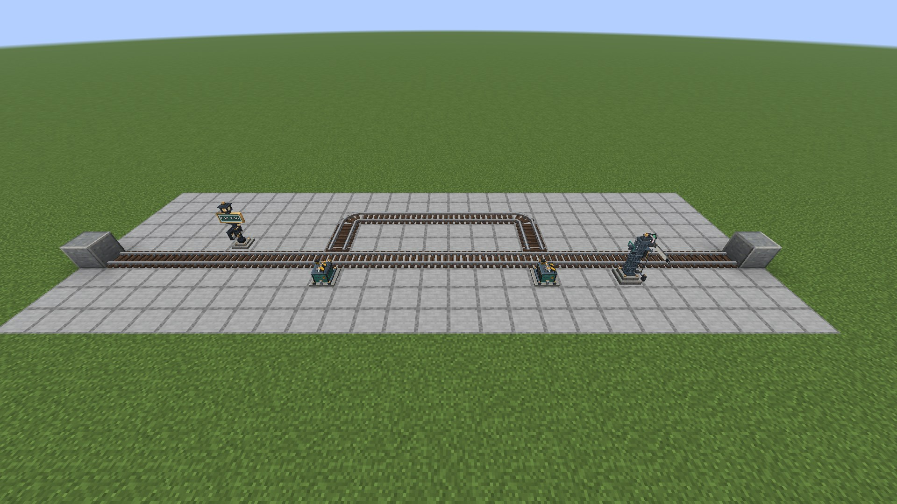
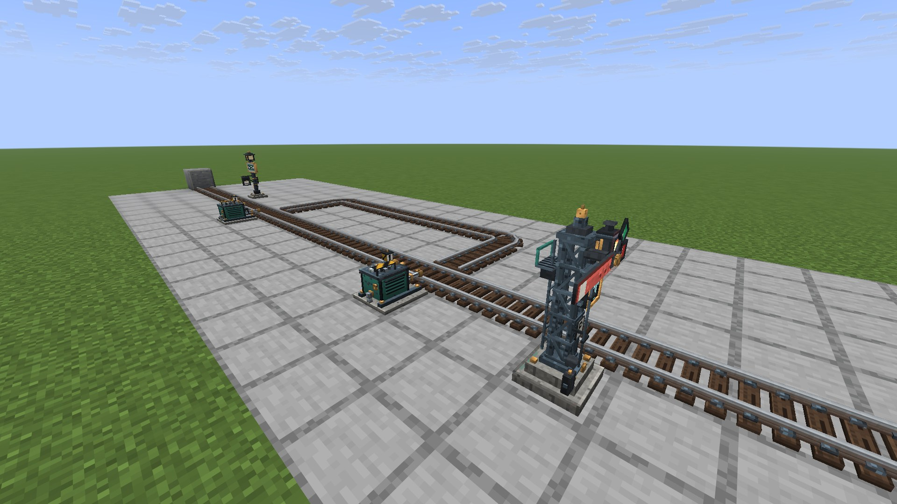
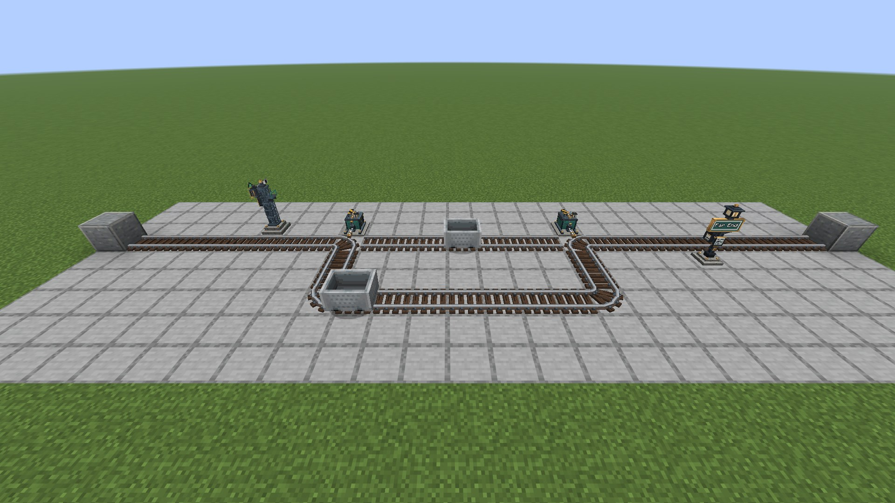

# Passing loop with detour

A single-track line with a passing loop. When the main track between the two switches is occupied, the path signal
routes the train through the loop instead.



## What it shows

* Two **switch motors**, one at each end of the loop.
* A **path signal** in front of the first switch. It looks for a free route to the destination and takes the loop
  when the direct route is blocked (detour).
* A station marker `Far End` behind the loop.



## Try it

1. Put a minecart on the main track between the two switches and leave it there.
2. Give a second minecart a ticket to `Far End` (right-click the marker with a ticket, then the cart) and push it from
   the west end.
3. The direct route is occupied: the path signal reserves the route through the loop, both switches turn and the
   cart drives around the parked one to `Far End`.



## Build your own

* A detour is only taken when it actually reaches the destination; otherwise the train waits at the signal.
* For traffic in both directions, add a path signal for the other direction at the east end as well.

## Place it in your world

The layout ships inside the mod. In a creative world with cheats, stand on flat ground and run:

```
/place template signalsreforged:wiki/passing_loop ~ ~-1 ~
```

The layout starts at your position and extends to the east (+X) and south (+Z); its floor replaces the ground block
under your feet. You can also use a structure block in **Load** mode with the name `signalsreforged:wiki/passing_loop`.
The same structure as a file: [passing_loop.nbt](https://github.com/CptGummiball/SignalsReforged/raw/main/structures/passing_loop.nbt) (for example for
`<world>/generated/signalsreforged/structure/wiki/passing_loop.nbt` or a world editor).

You may rotate it (for example `/place template signalsreforged:wiki/passing_loop ~ ~-1 ~ clockwise_90`), but do **not mirror**
it: repeaters, rail links and the signal box would point the wrong way. Station markers in a copied layout become new
stations with the same names (and the same private setting); tickets for the original stations stay valid.

## Materials

<!-- materials:begin -->
Size: 26 x 6 x 9 blocks (width x height x depth, floor included). 277 blocks in total.

| Block | Count |
|---|---:|
| Path Signal (`signalsreforged:path_signal`) | 1 |
| Station Marker (`signalsreforged:station_marker`) | 1 |
| Switch Motor (`signalsreforged:switch_motor`) | 2 |
| Polished Andesite (`minecraft:polished_andesite`) | 2 |
| Rail (`minecraft:rail`) | 37 |
| Smooth Stone (`minecraft:smooth_stone`) | 234 |
<!-- materials:end -->
