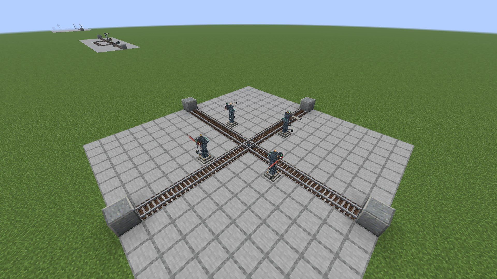
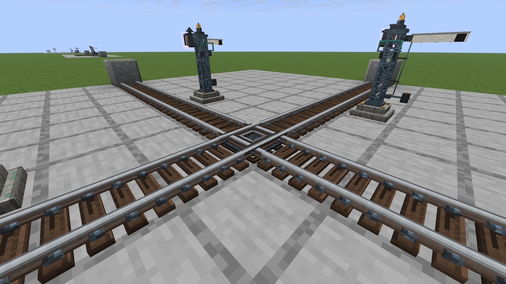
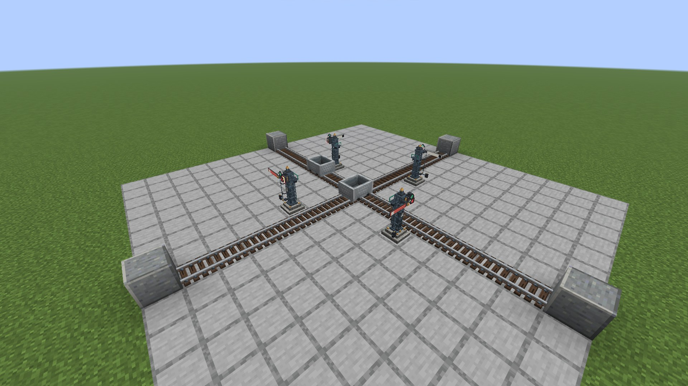

# Rail crossing protected by signals

Two lines cross at grade on a **Rail Crossing** block. Signals in front of the crossing on both lines make sure only
one train is in the crossing at a time.



## What it shows

* The **Rail Crossing** block connects all four directions; carts run straight across it and never turn.
* Every approach has a block signal facing the crossing (four signals, one per direction). A train reserves the
  crossing together with its block; while one train has it, the signals of the other line show STOP.



## Try it

1. Push one minecart from the west end and one from the north end at the same time.
2. The first one to reserve the crossing gets PROCEED; the other one waits at its signal until the crossing is clear
   again, then continues.



## Build your own

* Give **every** approach a signal facing the crossing. With an unsignalled approach the whole crossing becomes one
  shared block (a cart coming from there is still seen), and two trains reaching it at the same time can then wait
  for each other.
* Use a chain signal instead of the block signal in front of the crossing when the block behind it is long, so no
  train stops on the crossing.

## Place it in your world

The layout ships inside the mod. In a creative world with cheats, stand on flat ground and run:

```
/place template signalsreforged:wiki/rail_crossing ~ ~-1 ~
```

The layout starts at your position and extends to the east (+X) and south (+Z); its floor replaces the ground block
under your feet. You can also use a structure block in **Load** mode with the name `signalsreforged:wiki/rail_crossing`.
The same structure as a file: [rail_crossing.nbt](https://github.com/CptGummiball/SignalsReforged/raw/main/structures/rail_crossing.nbt) (for example for
`<world>/generated/signalsreforged/structure/wiki/rail_crossing.nbt` or a world editor).

You may rotate it (for example `/place template signalsreforged:wiki/rail_crossing ~ ~-1 ~ clockwise_90`), but do **not mirror**
it: repeaters, rail links and the signal box would point the wrong way. Station markers in a copied layout become new
stations with the same names (and the same private setting); tickets for the original stations stay valid.

## Materials

<!-- materials:begin -->
Size: 17 x 6 x 17 blocks (width x height x depth, floor included). 326 blocks in total.

| Block | Count |
|---|---:|
| Block Signal (`signalsreforged:block_signal`) | 4 |
| Rail Crossing (`signalsreforged:rail_crossing`) | 1 |
| Polished Andesite (`minecraft:polished_andesite`) | 4 |
| Rail (`minecraft:rail`) | 28 |
| Smooth Stone (`minecraft:smooth_stone`) | 289 |
<!-- materials:end -->
