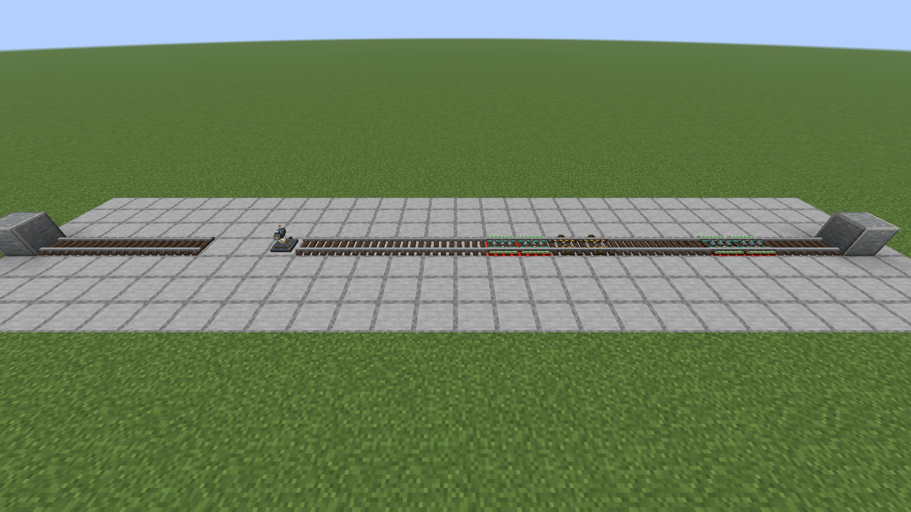
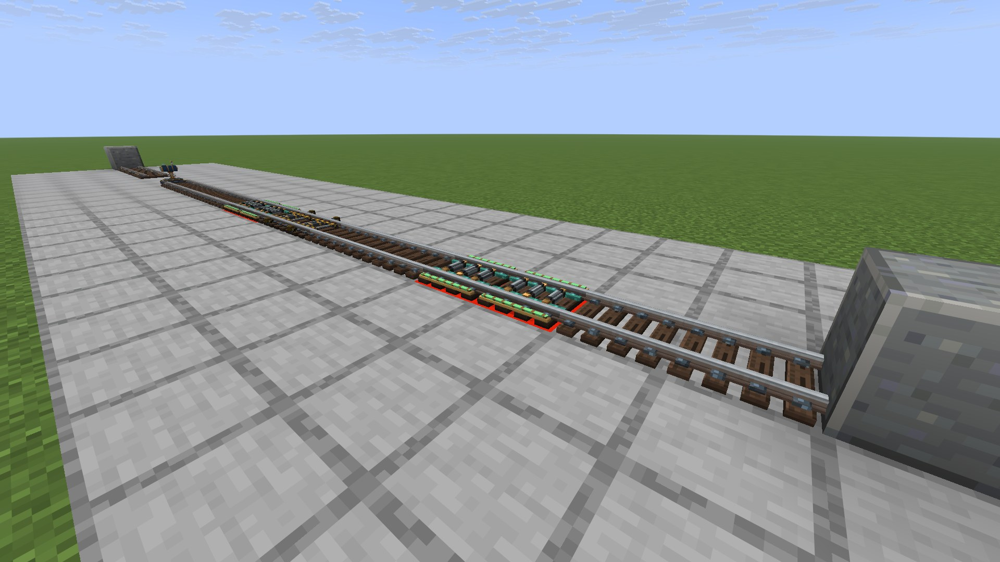
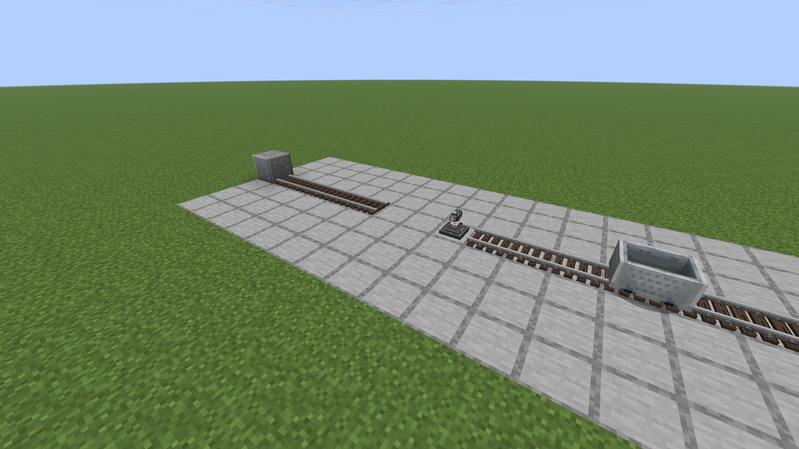

# Transport rails, limiter rails and a rail link

A line with the special rails: powered transport rails launch carts, limiter rails slow them down, and a second pair
of transport rails speeds them up again. At the east end a rail link joins the network across a gap in the track.



## What it shows

* **Transport rails** with a redstone block under them push carts forward when powered; unpowered they brake.
* **Limiter rails** cap the speed of carts that pass over them (unless powered); routed trains also plan with these
  limits.
* A **rail link** beside a track end joins it with another track end in the network graph, one-way. Carts do not
  move through it: use it where carts cross a gap by other means (a portal, a lift or a launcher), so blocks,
  reservations and signals still span the gap. The section behind the link stays occupied until the train is seen
  again beyond it, and at least for the hold delay (right-click the link to change it).



## Try it

1. Put a minecart on the first transport rails and give it a push to the east: the rails launch it.
2. It slows down on the limiter rails, gets launched again by the second pair and runs to the track end at the gap.



## Build your own

* Unpowered limiter rails cap the speed at 0.1 blocks per tick. A cart that slow rolls only about two more blocks, so
  put a launch (transport rails, powered rails or a signal) right after a limiter section.
* Link a rail link with the rail configurator: right-click the target track end (stores it), then sneak + right-click
  the rail link.
* The teleport rail moves carts between dimensions (operator opt-in); it is not part of this layout.

## Place it in your world

The layout ships inside the mod. In a creative world with cheats, stand on flat ground and run:

```
/place template signalsreforged:wiki/special_rails ~ ~-1 ~
```

The layout starts at your position and extends to the east (+X) and south (+Z); its floor replaces the ground block
under your feet. You can also use a structure block in **Load** mode with the name `signalsreforged:wiki/special_rails`.
The same structure as a file: [special_rails.nbt](https://github.com/CptGummiball/SignalsReforged/raw/main/structures/special_rails.nbt) (for example for
`<world>/generated/signalsreforged/structure/wiki/special_rails.nbt` or a world editor).

You may rotate it (for example `/place template signalsreforged:wiki/special_rails ~ ~-1 ~ clockwise_90`), but do **not mirror**
it: repeaters, rail links and the signal box would point the wrong way. Station markers in a copied layout become new
stations with the same names (and the same private setting); tickets for the original stations stay valid.

## Materials

<!-- materials:begin -->
Size: 28 x 6 x 7 blocks (width x height x depth, floor included). 221 blocks in total.

| Block | Count |
|---|---:|
| Limiter Rail (`signalsreforged:limiter_rail`) | 2 |
| Rail Link (`signalsreforged:rail_link`) | 1 |
| Transport Rail (`signalsreforged:transport_rail`) | 4 |
| Block of Redstone (`minecraft:redstone_block`) | 4 |
| Polished Andesite (`minecraft:polished_andesite`) | 2 |
| Rail (`minecraft:rail`) | 16 |
| Smooth Stone (`minecraft:smooth_stone`) | 192 |
<!-- materials:end -->
