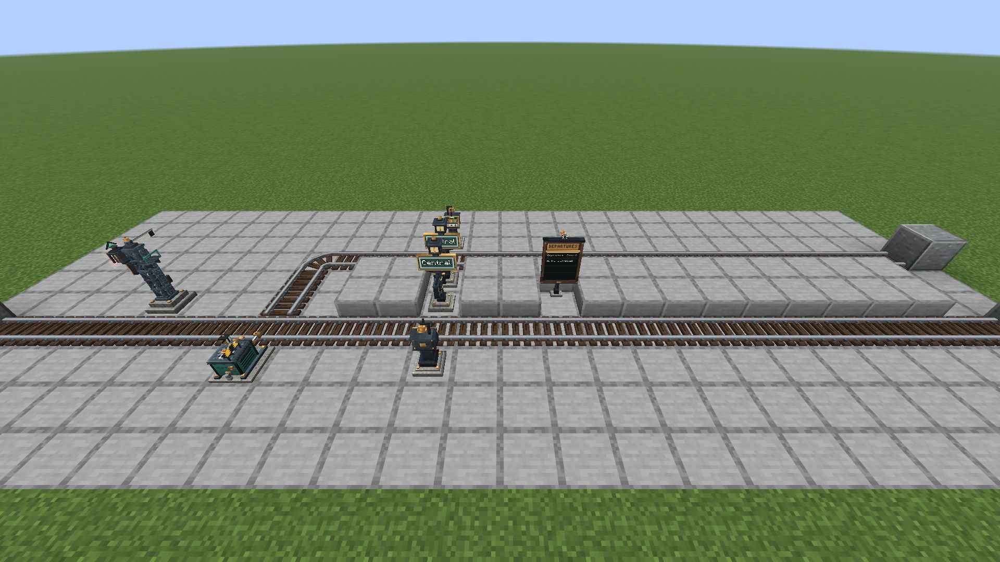
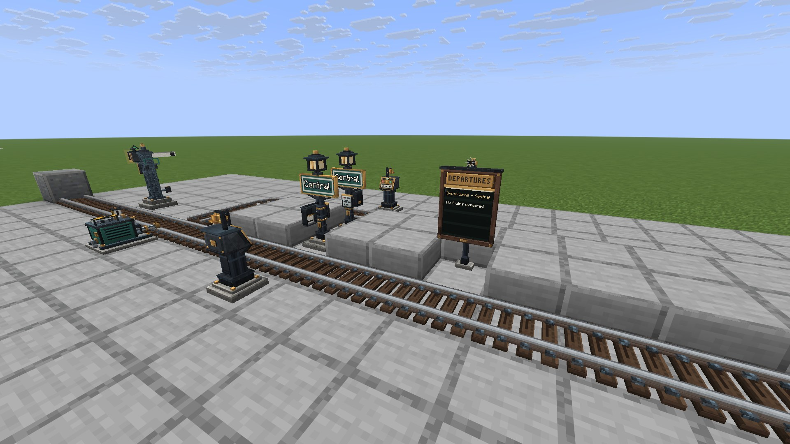
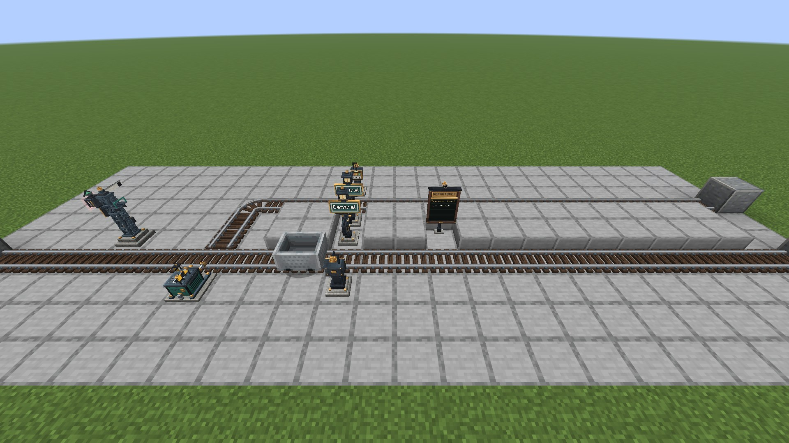
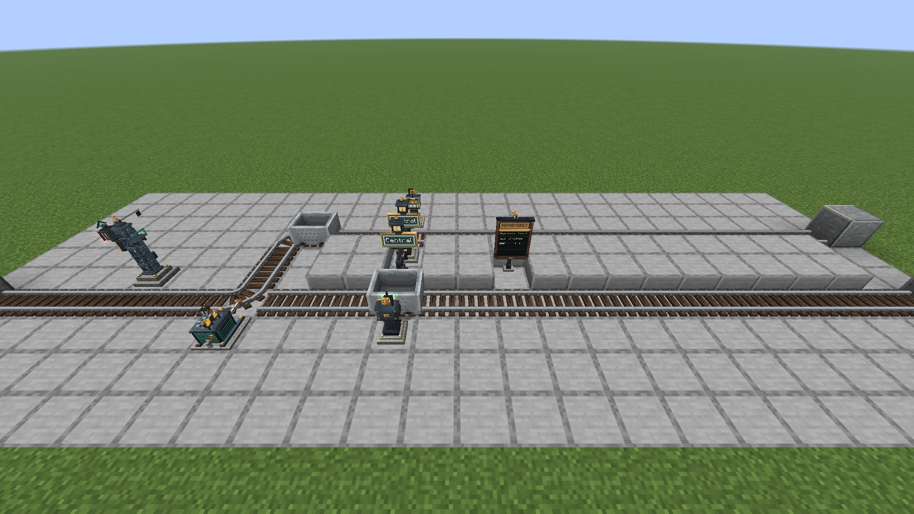

# Station with two platforms

A station with two platforms. Both station markers carry the same name, so they form one station `Central`; a train
gets a free platform, the one with the higher priority first.



## What it shows

* Two **station markers** named `Central`, one per platform track. Markers with the same name within 48 blocks (and
  the same public/private setting) are platforms of one station.
* Platform priorities: the south platform has priority 9, the north one 5. Set it in the station screen (right-click
  a marker).
* A **path signal** and a **switch motor** in front of the platforms send each train to its platform.
* Two **platform controllers** (dwell time on right-click, redstone while a train stands there, redstone on the back
  holds departures) and a **departure board** with the next trains.



## Try it

1. Give a minecart a ticket to `Central` and push it from the west end: it takes the south platform (priority 9).
2. While it stands there, send a second cart to `Central`: the south platform is taken, so it gets the north one.




## Build your own

* Name markers by renaming the marker item in an anvil before placing it, or in the station screen.
* A ticket to any platform of a station counts for the whole station; the train takes a free platform.

## Place it in your world

The layout ships inside the mod. In a creative world with cheats, stand on flat ground and run:

```
/place template signalsreforged:wiki/station_platforms ~ ~-1 ~
```

The layout starts at your position and extends to the east (+X) and south (+Z); its floor replaces the ground block
under your feet. You can also use a structure block in **Load** mode with the name `signalsreforged:wiki/station_platforms`.
The same structure as a file: [station_platforms.nbt](https://github.com/CptGummiball/SignalsReforged/raw/main/structures/station_platforms.nbt) (for example for
`<world>/generated/signalsreforged/structure/wiki/station_platforms.nbt` or a world editor).

You may rotate it (for example `/place template signalsreforged:wiki/station_platforms ~ ~-1 ~ clockwise_90`), but do **not mirror**
it: repeaters, rail links and the signal box would point the wrong way. Station markers in a copied layout become new
stations with the same names (and the same private setting); tickets for the original stations stay valid.

## Materials

<!-- materials:begin -->
Size: 26 x 6 x 10 blocks (width x height x depth, floor included). 341 blocks in total.

| Block | Count |
|---|---:|
| Departure Board (`signalsreforged:timetable_board`) | 1 |
| Path Signal (`signalsreforged:path_signal`) | 1 |
| Platform Controller (`signalsreforged:platform_controller`) | 2 |
| Station Marker (`signalsreforged:station_marker`) | 2 |
| Switch Motor (`signalsreforged:switch_motor`) | 1 |
| Polished Andesite (`minecraft:polished_andesite`) | 3 |
| Rail (`minecraft:rail`) | 44 |
| Smooth Stone (`minecraft:smooth_stone`) | 260 |
| Smooth Stone Slab (`minecraft:smooth_stone_slab`) | 27 |
<!-- materials:end -->
